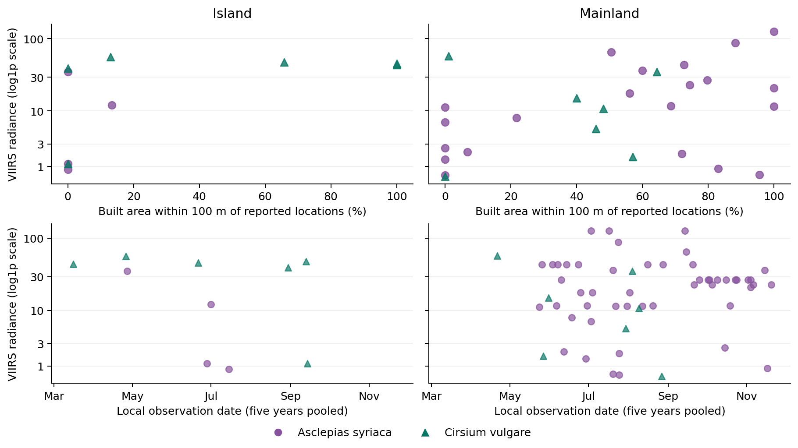

# 北米北東部の同じ区画でトウワタとアザミの寄与が逆になった理由

対象は *Asclepias syriaca*（トウワタ属）と *Cirsium vulgare*（アメリカオニアザミ）。西経75～70°・北緯40～45°の同じ5°区画で、2019、2021、2023、2024、2025年に照合した。固定した全球主要結果 −1.902 と64種の花粉制限の副次結果はそのまま扱う。全球モデルでこの区画の記録が各種の島−本土差に寄与した値は −0.1964 と +0.1396。以下の区画内の推定とは、係数を決める標本・重みの用途が違う。[全球の種別・地域別分解](ALAN_SIX_SPECIES_LIGHT_CONTRASTS.md)

## 撮影された生育環境には逆向きの偏りがある

両種のいずれかが写ったのは元の835地点年中37地点年、33個の0.05°格子。両種が写った1地点年を各種に数えると38種×地点年、写真は73観察。全件で原写真IDと現地観察日を照合し、撮影年の衛星土地被覆と当年の元のVIIRS輝度を結合した。表は同一種・地点年の複数観察を先に平均し、地点年を等重みにした中央値である。[地点別の全38行・日付・元モデル寄与](../results/local_21_26/focal_dated_sites.csv)・[年別衛星画像と品質](ALAN_21_26_LANDCOVER.md)

| 種・場所 | 地点年 | 観察 | VIIRS輝度 | 格子全体の人工被覆 | 撮影位置100 mの人工被覆 | 同じ100 mの草地・低木等 |
|---|---:|---:|---:|---:|---:|---:|
| トウワタ・島 | 4 | 4 | 6.68 | 58.7% | 0.0% | 92.2% |
| アザミ・島 | 6 | 6 | 45.40 | 87.4% | 39.4% | 2.7% |
| トウワタ・本土 | 21 | 56 | 11.59 | 82.5% | 68.7% | 0.0% |
| アザミ・本土 | 7 | 7 | 10.75 | 62.6% | 45.8% | 34.6% |

島でのトウワタはアザミより開けた草地・低木等に偏り、本土では人工被覆の多い場所に偏った。島のトウワタ4件で報告された位置精度は5～1,037 mで、3件は100 mを超える。報告された精度まで周辺を広げると、島のトウワタの草地・低木等の中央値は **46.5%**、人工被覆は **8.5%**。アザミは全6件の精度が100 m以内で、それぞれ2.7%、39.4%だった。方向は残るが差の大きさは位置精度に依存する。衛星で分かるのは周辺の地表被覆であり、草刈り、路肩・庭・公園の管理、個体に当たる光までは分からない。[島の位置精度と個別被覆](../results/local_21_26/island_accuracy_cover.csv)・[全記録の位置精度](../results/local_21_26/photo_precision.csv)

上段は種×地点年、下段は種×地点年×記録日の点。観察時期は5年を同じ暦に重ねている。日付には元の現地観察日を使用し、撮影機器の時計は検証していない。y軸は元の同年VIIRS放射輝度（nW cm⁻² sr⁻¹）のlog(1＋値)表示。

## 同じ場所・同じ時期で比較できるか

5年間に両種が写った物理格子は4つ（島2・本土2）。同じ年にも写ったのは島の1格子だけで、2025年6月28日のトウワタと9月14日のアザミで78日離れていた。公表座標間の距離は約80 mだが、トウワタの報告精度が1,037 mなので、同じ草地の個体と確定できない。別の島の共通格子では2019年4月のトウワタと2023年8月のアザミがいずれも草地率の高い100 m圏で写り、格子全体の人工被覆は両年約88%。両種が完全に異なる環境を占めるという解釈には合わない。[地点ごとの観察日と環境](../results/local_21_26/focal_dated_sites.csv)

区画内の異なる地点を許しても、同じ陸塊区分・同年・同月で両種が記録されたのは2021年7月の本土だけだった。トウワタ2地点のVIIRSは0.53と87.58、アザミ1地点は5.36で、同月内でもトウワタが一律に暗所に寄る結果ではない。全観察で開花の注釈が付いたのはトウワタ5/60、アザミ3/13。注釈の欠測は未開花と数えない。2025年の本土トウワタ49記録は49人から得られた一方、同年の本土アザミは0件。撮影時期と対象選択の偏りは残り、初見・終見を開花期に読み替えることはできない。[月別照合](../results/local_21_26/photographic_months.csv)・[注釈照合](../results/local_21_26/photo_support.json)

## 全撮影地点で環境と時期を考慮した場合

焦点種が写らなかった798地点年も含め、835地点年（島83／本土752）を同じ分母にした。元の共変量と年固定効果に、同年の格子内の人工被覆・開放地・水域率を加え、さらにその地点年の全植物の撮影日の季節分布（年周期のsin・cos）を加えた。対象種の応答は「その種が撮影された」×100／全撮影種数。局所での島−本土の傾き差を示す。係数は構成比の百分率ポイント／log(1＋VIIRS)。[モデルの定義・各側の傾き](ALAN_21_26_BACKGROUND.md)

| 種 | 元の共変量 | 同年土地被覆を追加 | 土地被覆＋撮影季節 |
|---|---:|---:|---:|
| トウワタ | −1.374 | −1.179 | −1.190 |
| アザミ | +0.458 | +0.711 | +0.748 |

トウワタでは負の差の絶対値が13.5%縮まり、変化のほとんどが被覆を加えた段階で生じた。アザミでは正の差が大きくなり、調整後は島 +1.089、本土 +0.342。つまりアザミが本土の明所で減ったという結果は調整後には残らず、島側の増加幅が大きいことが残った。2種の局地差の開きは1.83から1.94ポイントになった。**撮影された生育場所は明らかに異なるが、今回測れた土地被覆・平均的な撮影季節では2種の差の向きを説明し切れない。** VIIRSと人工被覆の順位相関は島0.743、本土0.911。島の焦点種記録は4・6地点年しかなく、5°区画は1個なので全球設計の地域クラスタ信頼区間は出せない。13.5%は係数の変化量で、因果的な説明率や光の固有効果の推定には使えない。[局地係数](../results/local_21_26/background_local_slopes.csv)

## 島と本土の送粉者は違うか

区画内で同じ年に「どの昆虫がどの花を訪れたか」と明示した記録を原観察に戻って確認した。対象5年のトウワタでは島165／本土1,627件、うち蛾19／195件。アザミは島12／本土97件、うち蛾0／2件。これらは観察者が報告した正の訪花記録で、ゼロを含む定時調査ではない。さらに元の焦点植物の0.05°格子・物理陸塊・年に合わせるとトウワタは島0／本土8、アザミは0／0となり、植物観察日まで一致した記録は両種とも0。トウワタで両側に共通した訪花昆虫は39種で、例えば蛾 *Eichlinia cucurbitae* は島8／本土46件、マルハナバチ *Bombus griseocollis* は39／234件。アザミでも *Bombus impatiens* が島2／本土18件記録された。従って、少なくともこれらの訪花種は両側に共通する。一方、両種に対し同じ標準化努力で、局地的な訪花頻度、同種花粉送達、種子への寄与を島と本土で比較する材料はそろわない。訪花の地域記録は今回の照合用であり、主要結果に使用した固定版GloBIのラベルを更新していない。[地理・原資料・調査努力の照合](ALAN_21_26_LOCAL_VISITORS.md)・[年・訪花者群別集計](../results/northeast_local_visitors/verified_visitors.csv)

なお、区画内の米国保全草地には実時間付きの調査があり、2023～24年に特定のハチ群を対象にトウワタ150分、アザミ30分が植物別に確認できた。ただし公開表では島3草地と本土23草地の植物別結果が合算され、同年の元の陽性地点とは一致しない。[時間付き調査の原表と地理照合](ALAN_21_26_LOCAL_VISITORS.md)

同種の土地開発と送粉を調べた独立研究でも、トウワタでは訪花・花粉塊の移送と最終的な繁殖成績との関係が測定項目で変わった。今回の結果で最も直接に示せた過程は、島の明所・暗所で撮影対象になった植物が異なる被覆の中にあったこと。昼夜の送粉機能の変化と生育地・観察場所の選択を分けるには、その場所と開花日に対応した有効訪花が必要になる。[トウワタの開発地・非開発地での比較](https://doi.org/10.1002/ece3.11494)

日付・元の構成比への寄与・被覆の表は `python scripts/analysis/alan_21_26_photo_habitat.py WORK_DIRECTORY results/local_21_26 --cover results/local_21_26/landcover.csv` で再生成できる。全835地点年のモデル、衛星画像、訪花原表の再現方法は各節の資料に記載した。
