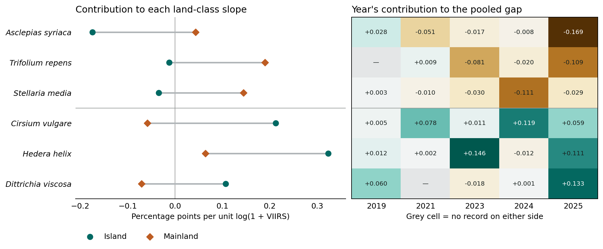

# 島と本土で夜間光に沿った種構成が大きく異なる植物を読む

固定した主要結果は、78地域・10,698地点年における、蛾の訪花記録がある植物の撮影種中割合の島−本土の傾き差 −1.902。花粉制限64種の傾向は副次結果とする。ここでは旧版で島と本土に共通する544種を寄与の符号付き点推定で並べ、両端の各3種を選んだ。選択数は解釈のための判断であり、有意水準・強い個体群応答の判定基準を表さない。6種の絶対寄与は544種の絶対寄与総和の6.93%。符号付き合計は **+0.109** で、上位6種が主要な負の係数を作ったとはいえない。選んだ6種のうち、新旧両方で蛾訪花ありの種は *Cirsium vulgare* のみである。[主要結果](ALAN_GLOBI_PRIMARY_RESULT_FREEZE_20261111.md)・[544種表](../results/species_interpretation/shared_544.csv)

## 種別の大きさと地理的な支持

|種|島|本土|差|島／本土の陽性地点年|両側に記録のある地域年数|その地域年からの寄与|
|---|---:|---:|---:|---:|---:|---:|
|*Asclepias syriaca*|−0.174|+0.043|−0.217|5／30|4|−0.193|
|*Trifolium repens*|−0.012|+0.190|−0.202|4／48|2|−0.005|
|*Stellaria media*|−0.034|+0.144|−0.178|2／21|1|−0.003|
|*Cirsium vulgare*|+0.213|−0.058|+0.271|13／26|4|+0.143|
|*Hedera helix*|+0.323|+0.064|+0.259|9／17|3|+0.171|
|*Dittrichia viscosa*|+0.107|−0.070|+0.177|3／12|0|0.000|

数値は全撮影植物を分母とした1種の構成比の勾配、または勾配差への寄与（百分率ポイント／log(1＋同年VIIRS)）。右端は固定したデザインの寄与を、同じ種が両側に出現した5°地域・年について足したもの。限定標本で再推定した効果ではない。年別の寄与も同様に5年の係数に足し戻せる。地域ごとの集中度は、種ごとに「最大の地域寄与の絶対値／地域寄与の絶対値の総和」で求めた。物理的な地点で観察された種の存在や不在の確率とは区別する。[種別検算](../results/focal_species/ranked_contributions.csv)・[年別内訳](../results/focal_species/annual_contributions.csv)・[計算コード](../scripts/analysis/alan_ranked_species_evidence.py)

負側1位 *A. syriaca* と正側1位 *C. vulgare*・2位 *H. helix* は、最大寄与地域が同じ北米北東部（西経75～70°、北緯40～45°）だった。この1地域で絶対地域寄与の90%、50%、48%をそれぞれ占める。島で写った地点のVIIRS中央値は順に6.68（4地点年）、45.39（6）、46.11（3）。本土では11.59（21）、10.74（7）、19.29（2）。この地理範囲で *A. syriaca* と *C. vulgare* が同じ0.05°地点年で写ったのは1件。*H. helix* と他の2種の組合せは各0件。共通地域の中でも照明や土地利用の異なる生育地・撮影場所を比較している可能性が残る。*C. vulgare* の寄与は5観測年すべて正だが、*A. syriaca* は2019年に正、2025年だけで −0.169 を占めた。[共通地域の衛星輝度](../results/focal_species/common_region_radiance.csv)・[年別内訳](../results/focal_species/annual_contributions.csv)

## 生態的に識別しやすい3種

**負側のトウワタ属 *A. syriaca* では、捕食リスク、訪花、繁殖を切り分けられる。** 蛾が花粉塊を運ぶものの、昼だけ開放した花が夜だけの花の約8倍の成熟果実をつけた集団がある。クモを操作した別の実験で、訪花者の行動変化は種子数・重量の検出可能な差につながらなかった。トロントの公園では外来ミツバチが昼間の送粉の99%超を担ったと推定されている。光とともに変化し得るのは夜の蛾だけでなく、昼の訪花者の供給も含む。1979～2010年のメイン州では、同種の開花、ハチの初訪花、カニグモの初産卵が異なる速度で早まった。季節のずれを測れる実例だが、温度変化を扱い、夜間光と蛾は比較していない。[昼夜の成熟果実比較](https://pubmed.ncbi.nlm.nih.gov/28310486/)・[クモ操作](https://doi.org/10.2980/i1195-6860-12-2-244.1)・[都市公園の送粉](https://doi.org/10.1002/ece3.3394)・[季節の長期観察](https://www.americanarachnology.org/journal-joa/joa-all-articles/article/download/arac-46-1-31.pdf/)

**正側の *C. vulgare* は、地域によって繁殖を支える経路が変わり得る例である。** ニュージーランドでは生存可能種子が無受粉区1%、自家受粉区6%、他家受粉区92%。北カリフォルニアでは昆虫を遮った頭花でも種子を形成した。蛾体表の花粉と昼のハチの訪花はともに知られているが、2地域の研究は種子の生存性と数など測定法が異なる。島でハチから蛾に交代した証拠として結合できない。北パタゴニアではハチ相の交代に伴う柱頭の異種花粉の変化も調べられており、「誰が来たか」と「他家花粉がどれだけ届いたか」の区別が有効である。[ニュージーランドの実験](https://doi.org/10.1080/0028825X.1989.10414121)・[カリフォルニアの実験](https://doi.org/10.1007/s10530-010-9878-5)・[パタゴニアでのハチ密度操作](https://doi.org/10.1007/s13744-020-00787-6)

**正側のキヅタ *H. helix* は、捕食者自身の送粉と季節の同期を考える上で最も具体的である。** 英国で *Vespula* 属の活動量と結実率に正の関連があり、*Colletes hederae* の雌は秋の開花ピークに活動を合わせていた。キヅタを強く選ぶハナバチがいても、キヅタの有効訪花者は複数群にまたがる。近縁の別種 *H. hibernica* ではツマアカスズメバチが最頻の吸蜜者となっても、高密度地点では1果当たり種子数が少なかった。捕食者の訪花増だけで、排除・捕食された訪花者の機能を補えたとは判断できない。*H. helix* の+0.259がこの機構によるか、光でキヅタとハナバチの季節の重なりが縮むかは未測定。[キヅタとスズメバチ](https://doi.org/10.1007/s11829-009-9080-9)・[キヅタと雌バチの同期](https://doi.org/10.1007/s11829-021-09807-7)・[近縁別種での捕食・訪花・種子](https://doi.org/10.1016/j.baae.2023.07.005)

## 他の3種が区別する仮説

- *T. repens* は白花で蛾体表に花粉が見つかる一方、採種圃場のハチ排除で種子収量が40.3から1.3 g/区に低下した。テルセイラ島ではミツバチ32、マルハナバチの一種18、捕食性の *Vespula germanica* 4件の訪花が同じ植物に記録された。暗期を中断する実験では花序形成が促進された。植物への直接作用、昼のハチによる送粉、捕食性ハチの訪花という三つの経路をもつが、負の寄与の大部分は同じ地域年に種が両側で写らなかった記録に由来する。[ハチ排除](https://doi.org/10.1071/EA9941121)・[島の付表B5](https://repositorio.uac.pt/bitstreams/9839ce35-86d7-4672-80a1-ad035724803f/download)・[暗期中断](https://doi.org/10.1080/0028825X.1981.10426393)
- *S. media* は自動自家受粉が観察されている。英国の共通栽培ではSkomer島や道端由来の系統の多くが早く繁殖に至った。ここでは集団の生活史の違いも候補になる。島の写真は2地点年で、負の差は本土の正の傾きが大きいことから生じる。[直接観察と実験出典](ALAN_NEGATIVE_TAIL_ECOLOGY.md)
- *D. viscosa* はコルシカ島で秋のハナアブに利用された。ハナアブが全植物に行った訪花の11%がこの種に向かった。島の日中の利用者は具体化できるが、同じ5°地域年でこの植物が島・本土両側に写った例が0のため、+0.177から島の送粉者交代を読み取れない。[コルシカの季節調査](https://doi.org/10.1111/jen.13379)

シロツメクサではクモ *Argiope bruennichi* → 成虫の蛾 *Euclidia glyphica* → 植物の種名連鎖があり、同年・同陸塊の1°格子に3者がそろう元の植物地点年は島0／本土6、0.05°では0／0だった。島290分・本土56分の時間付き訪花調査も英国と米国に分かれる。トウワタでは元の14地域年に島70／本土6,047件の開花状態観察があるが、いずれも明暗×島本土が4区分そろわなかった。記録数の多さだけでは、捕食・送粉や季節のずれを同じ条件で比較できない。[6種別の地理・時間・観察努力](ALAN_FOCAL_INTERACTION_SUPPORT.md)

6種のいずれも、夜に活動する特定の蛾への依存が明暗・島本土間の繁殖差を作ったところまで直接示した例は確認できなかった。証拠がもっとも揃うのは、特定の地域・種での昼夜の送粉効果や、捕食性の訪花者が生殖にかかわる段階である。旧版の全球訪花ラベルだけではこの違いを区別できない。同じ花で捕食が発生した時間と、各訪花者が実際に届けた他家花粉・形成された健全な種子を結び付ける比較が、代替が成立するかを判別する。[正側3種の原著レビュー](ALAN_POSITIVE_TAIL_ECOLOGY.md)・[負側3種の原著レビュー](ALAN_NEGATIVE_TAIL_ECOLOGY.md)・[元の調査範囲での種別照合](ALAN_FOCAL_INTERACTION_SUPPORT.md)

再集計は既存の非公開座標を含む原入力に対して `python scripts/analysis/alan_ranked_species_evidence.py INPUTS SIGNED results/focal_species` で実行する。公開CSVからは `python scripts/analysis/plot_alan_ranked_species.py` で図を再作成できる。
