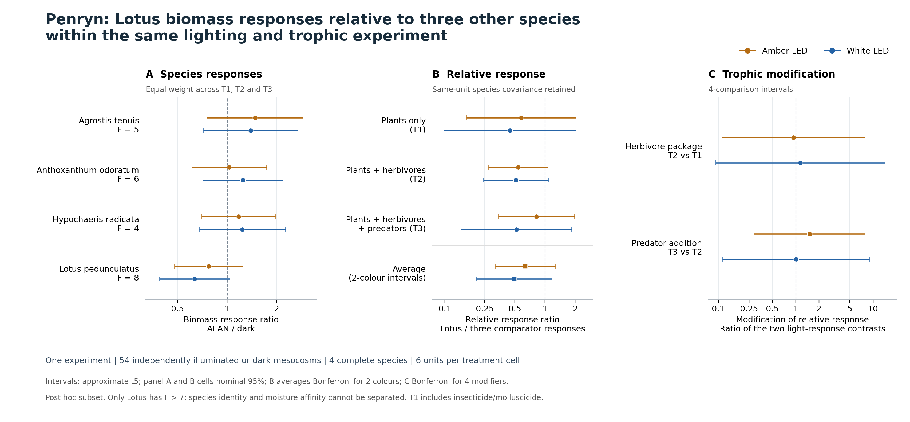

# 同じ54区画における湿潤性植物の相対応答と栄養段階の修飾

2026-11-21。現行main `db82976` を確認して追加した探索的解析。
**湿潤性の高いLotus pedunculatusの照明応答は他3種より小さい点推定を示したが、
2光色を考慮した区間は1を含み、植食者・捕食者による応答の増強も確定できなかった。**
既存の3つの段階別メタ解析と、長期記録における湿潤種の偏りは再推定していない。

## 新しく検定した問い

Penrynの同一照明実験には、植物のみ（T1）、植物＋植食者（T2）、植物＋植食者＋捕食者（T3）
と、暗区・琥珀色LED・白色LEDを組み合わせた9条件がある。原著のMethods 2.1では各条件6区画を
無作為配置し、照明区ごとにLEDを設置している。生物量は2016年8月の最終収穫で、地上部と地下部の合計である。
[Anic et al. 2022](https://doi.org/10.1002/ece3.9157)。

今回の比較は、同じ54区画すべてに生物量があり、補足表S1の生残区画数とも一致する4種に限定した。
54区画の記録があっても生残表と不一致のあるCentaurea nigraは含めなかった。未掲載の生物量をゼロにせず、
採用した4種では216行すべての実測値を使った。

| 原表の種名 | PLANTATT湿潤性F | 日中の光環境への親和性L | 記録・生残表の一致 |
|---|---:|---:|---:|
| Agrostis tenuis（A. capillarisへ同物異名照合） | 5 | 6 | 54/54区画 |
| Anthoxanthum odoratum | 6 | 7 | 54/54区画 |
| Hypochaeris radicata | 4 | 8 | 54/54区画 |
| Lotus pedunculatus | 8 | 7 | 54/54区画 |

指標はKew公開の英国・アイルランドのPLANTATT列から再抽出し、元CSVのハッシュを照合した。
欧州EIVや実験区の土壌水分と混同しない。
[値・照合方法・元資料](../../database/alan_experiments/plant_sources/complete_species_trophic/penryn_four_species_PLANTATT_verified.json)。

各種の「照明下の平均生物量／暗区の平均生物量」を求め、Lotusの比を他3種の比の幾何平均で割った。
これは**照明に対する比例的な応答の種間差**であり、群集全体に占めるLotusの割合そのものではない。
同一区画内の種間共分散、琥珀色・白色が共有する暗区を保った24効果量・24×24共分散から計算した。
3栄養段階の周辺値は対数尺度で等重み平均した。

## 結果：相対的な植物応答

| 光色 | Lotusの照明／暗区生物量比 | 他3種に対する相対応答比 | 2光色を考慮した近似95%区間 |
|---|---:|---:|---:|
| 琥珀色LED | 0.773 | **0.636** | **0.319–1.267** |
| 白色LED | 0.635 | **0.492** | **0.206–1.173** |

相対応答比は1より小さい点推定で、3栄養段階×2光色の6条件でもすべて1未満だった。
ただし同一実験の依存した比較であり、6つの独立実験による再現ではない。
白色の通常の近似95%区間は0.242–0.997で上端がわずかに1を下回るが、
2光色のBonferroni区間では1を含む。確証的に有意な湿潤性効果とは扱わない。

## 結果：植食者・捕食者で差は変わるか

相対応答のT2/T1比が1未満なら植食者処理によってLotus側の応答がさらに相対的に小さくなり、
T3/T2比は捕食者添加による変化を表す。処理ごとの有意・非有意を見比べず、対比の差を直接推定した。

| 修飾対比 | 琥珀色LEDの比［通常の近似95%区間］ | 白色LEDの比［通常の近似95%区間］ |
|---|---:|---:|
| 植食者処理：T2対T1 | 0.936［0.223–3.931］ | 1.147［0.210–6.257］ |
| 捕食者添加：T3対T2 | 1.519［0.499–4.624］ | 1.011［0.231–4.423］ |

4対比すべてで通常区間も同時比較区間も1を含んだ。相対生物量の変化が、植食者によって増幅された、
あるいは捕食者によって救済されたという明瞭な支持は得られない。区間が広いため、相互作用が存在しないとも結論しない。
T1では殺虫剤・殺軟体動物剤を継続使用しており、T2対T1は純粋な植食者数のみの操作ではなく処理一式の比較である。

## 感度と識別できないこと

比較種を1種ずつ使うと、相対応答比の点推定は琥珀色で0.521–0.750、白色で0.457–0.512で方向を維持した。
ただし6対比の通常区間はすべて1を含む。比較種を1種ずつ除く場合も点推定の方向は同じだった。
先に区画ごとの対数比を計算してから平均する別の推定対象でも、点推定は0.665、0.515となった。

Lotusと日中光指標Lが同じ7のAnthoxanthumだけと比較しても、点推定は0.750、0.508だった。
これは単純な日中光指標の違いに関する補助確認であり、夜間照明への生理的感受性を調整したものではない。
湿潤性Fが7を超える種はLotusのみで、種の個性・マメ科属性・湿潤性を分離できない。

採用種は全区画で生残した種の事後的部分集合であり、焦点種も先行結果を知った上で選んでいる。
区間は一次デルタ法とt分布（自由度5）による近似であり、この選択や小標本の限界を解消しない。
4種を4独立研究としてメタ回帰へ投入せず、既存Penryn実験のアブラムシ・花数・群集量と別研究として数えない。

## マクロの機構候補への位置づけ

今回追加できたのは、湿潤性の高い1種の相対生物量応答を、同じ実験区画に生育する他種と比較した結果である。
植物側の種特異的応答を候補として残せる一方、その差を植食者・捕食者操作の効果で説明できるという根拠は弱い。
直接の生理作用、資源競争などをこの設計で分離しておらず、どれかを機構として確定しない。

昆虫捕獲・捕食者修飾・食害の既存メタ解析と併記することで、機構候補を「相互作用変化があるはず」という説明から、
同一実験内でどの部分を支持できるかへ絞るための補足結果となる。マクロの湿潤種の記録率低下の媒介割合は推定しない。

## 図・検証・再現

[PDF](figures/penryn_complete_species_trophic.pdf)／[SVG](figures/penryn_complete_species_trophic.svg)。
パネルAは4種それぞれの応答、BはLotus対3種の応答比、Cは栄養段階の修飾である。
AとBの各処理は通常の近似95%区間、Bの周辺値は2光色、Cは4修飾対比に対するBonferroni区間を表示する。

元PDFを新たに取得しSHA256を確認した。別の抽出法による原表216行と、別の群平均・ヤコビアン計算による
24効果量および全共分散を照合した。欠測・重複・生残表の不一致、共有対照、共分散、質量単位変更を検査する6テストと、
既存DBの3テストが通過した。AIによる独立確認であり、人による二重抽出完了とはしない。
[再現コード・全結果・検証記録](../../database/alan_experiments/plant_sources/complete_species_trophic/README.md)。
