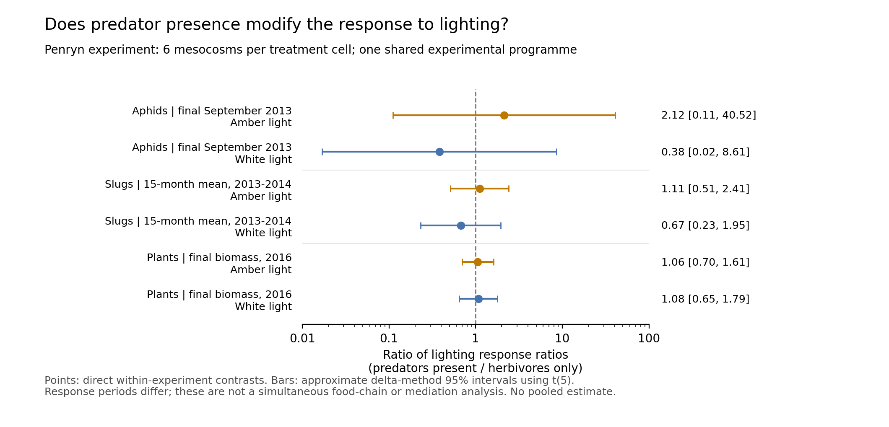

# 同一区画を共有するPenryn実験の捕食者対比

一つの実験系列内で、捕食者添加区の照明／暗区比を植食者のみの区の照明／暗区比で割った。比1は捕食者添加による照明応答の変化がないことに対応し、照明の主効果がないという意味ではない。各処理セルは6メソコスム。捕食者処理はゴミムシPterostichus melanariusとテントウムシAdalia bipunctataの導入を含み、特定の捕食者種の効果を分離していない。

| 応答・時点 | 琥珀色光：比〔近似95%区間〕 | 白色光：比〔近似95%区間〕 |
|---|---:|---:|
| アブラムシ数・2013年9月最終観測 | 2.124〔0.111–40.525〕 | 0.383〔0.017–8.610〕 |
| ナメクジ数・2013–2014年の観測15か月平均 | 1.111〔0.512–2.412〕 | 0.672〔0.232–1.945〕 |
| 植物バイオマス・2016年最終収穫 | 1.060〔0.697–1.612〕 | 1.076〔0.648–1.787〕 |

すべての区間が1を含む。異なる光色で植食者の点推定の方向は異なり、植物量まで一貫する捕食者による応答変化は確認できなかった。ただし区間は広く、無効果を証明する結果ではない。原著の反復時系列モデルとは推定対象が異なり、そのトップダウン効果の検定を再現・否定した解析ではない。

図：点は実験内対比、線はデルタ法と自由度5のt分布による近似95%区間。複数研究を統合した推定ではない。ナメクジの最終観測は暗区平均がゼロでlnRRを算出できないため、期間平均は補足的な別の推定対象として表示した。欠測月のゼロ補完はしていない。

元14効果量の共分散196要素と、6対比の共分散36要素を物理区画IDから計算した。応答間の観測時期が異なるため、共有区画の照合は同時期の媒介過程の検証を意味しない。アブラムシ対比は既存の段階別統合にも使われており、追加の独立実験として数えない。

[元データ・解析・検証](../../database/alan_experiments/bennie_trophic_sources/README.md)、[数値表](../../database/alan_experiments/bennie_trophic_sources/joint_predator_contrasts.csv)、[原著植物量研究](https://doi.org/10.1002/ece3.9157)、[原著栄養段階研究](https://doi.org/10.1111/1365-2664.13240)。
