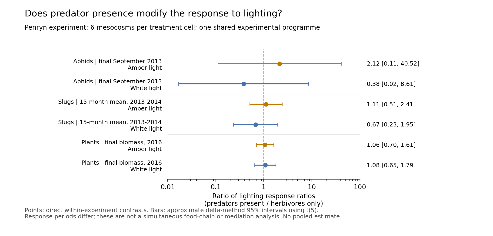
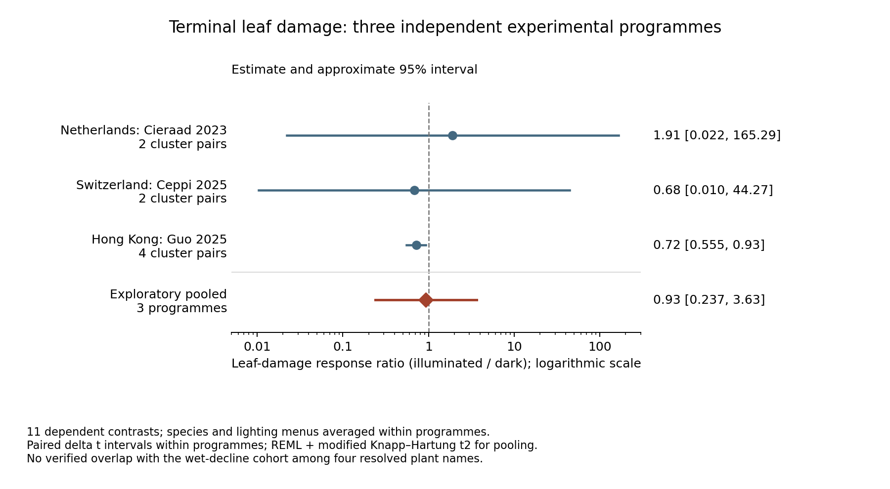

# 生物間相互作用の定量統合：結果本文案

追加確認：ケニアの17種を用いた屋外実験では、高栄養条件の在来植物群の総乾燥重量に対する照明応答は、競争相手なしで−34.0%、Ocimum gratissimumとの競争下で＋35.4%と原著に報告されていた。これは原著報告の条件別変化率であり、自前再解析による推定値ではない。照明は明暗各6区画で操作されたが、種・処理別ポットの区画配置と共分散を確認できず、統合効果には含めなかった。開花個体割合・花数も測定されたが、送粉成功・種子生産とは区別した。湿潤性を操作した研究でもない。[一次論文](https://doi.org/10.1111/1365-2745.14235)、[採択保留と抽出記録](../../database/alan_experiments/abonyo_sources/README.md)。

本稿には訪花・花粉送達の研究横断比較と、起源別捕獲、捕食者によるアブラムシ照明応答の変化、葉の食害量の探索的メタ解析を区別して収録する。探索的統合はそれぞれ2・2・3実験系列に限られ、最終採択済みの主メタ解析ではなく、照明操作を統合した湿潤性メタ回帰は未完了。既存のPageデータベースを再解析した部分と、構築中の一次論文からの自前抽出DBは異なる資料であり、同一の抽出成果と表記しない。

## 自前抽出した照明実験の収録範囲

2026年11月20日時点の効果量台帳には、11論文・10実験系列から108の有限なlnRRが収録された。うち2行は同じ応答の複数時点平均を用いた補足値であり、最終時点の効果と独立には数えなかった。Bennie2015とAnic2022は同じ54区画を共有していた。対応のある区画、共有暗区、同一区画の複数応答に基づく標本共分散を復元した。これは抽出段階の収録数であり、採択・第二確認が完了したメタ解析標本数ではない。

| 応答 | 台帳の有限効果量数 | 実験系列数 | 統合時の区別 |
|---|---:|---:|---|
| 水生・陸生起源昆虫の捕獲 | 18 | 2 | 起源を比較し、捕獲を個体群増加としない |
| 全無脊椎動物の捕獲 | 8 | 1 | 起源別内訳と独立には数えない |
| ヨコバイ科の捕獲 | 4 | 1 | 植食者全体とはしない |
| クモ個体数 | 3（うち補足1） | 2 | 最終時点と期間平均を重複させない |
| 網内獲物数 | 2（うち補足1） | 1 | 捕食率と区別する |
| 昼間の訪花 | 11 | 2 | 合計と内訳を重複させない |
| アブラムシ数 | 11 | 2 | 光色・捕食者導入・照度の実験内対比 |
| 寄生されたアブラムシのマミー数 | 7 | 1 | 最終時点の現存数であり寄生率ではない |
| 植物の食害 | 2 | 1 | 同じ区画を共有する植物種別応答 |
| 植物乾燥重量（枯死物込みの総量を含む） | 38 | 4 | 種個体、生体部分、枯死物込みの総量を区別する |
| 枯死植物材料の乾燥重量 | 4 | 1 | 生体部分と区別し、総量と重複させない |

実験系列数は応答間で重なるため、列の合計を独立実験数としない。花粉送達・結実・種子生産については、現在のこの台帳に採用可能な有限効果量がなく、統合値を推定しなかった。水分指標MOISTを完全学名一致で付与できた有限効果量は5植物種・3実験系列の10行だった。同一実験内の指標範囲は、草地の2種で7.9–8.1、水生単植の2種で11.9–12.0、残る実験は1種の5.1のみだった。研究間の指標差が実験条件と重なるため、湿潤種と乾燥種の照明応答差を十分に分離できず、湿潤性メタ回帰は未推定である。

新たにParkinson2023の原表30トラップから40比較を整理し、28比較で有限なlnRRを得た。これら28行は上記108行に含む。水上と隣接岸辺における全捕獲数の照明効果の差（lnRR水上−lnRR岸辺）は緑光+0.728、紫光+2.375、赤光−0.234、白色光+0.939だった。同一池・一夜の比較で、各色は暗区を共有する。両環境とも水辺であるため、湿潤系対乾燥系の効果差とはしなかった。クモは暗区平均がゼロでlnRRを算出せず、バイオマスは原表と集計表の不一致のため保留した。

資料：[抽出台帳](../../database/alan_experiments/effect_catalogue.csv)、[共分散検証](../../database/alan_experiments/sampling_covariance_audit.json)、[水分指標の支持範囲](../../database/alan_experiments/site_context/plant_endpoint_moisture.csv)、[Parkinson2023の原表照合](../../docs/ALAN_PARKINSON2023_EXTRACTION_20261120.md)、[一次論文](https://doi.org/10.1098/rstb.2022.0361)。

## 水生起源と陸生起源の捕獲応答の実験内対比

水生起源と陸生起源の捕獲が同じ照明条件・区画で測定された2実験系列について、起源間の照明応答差を計算した。Parkinson2020の水生起源の捕獲応答比を陸生起源の捕獲応答比で割った値は5.11（同一区画の共分散を考慮したデルタ法・正規近似95%区間2.66–9.79）だった。Parkinson2023では4光色×2設置環境の8対比すべてで点推定が1を上回り、応答比の比は1.45–14.04だった。白色光では水上7.33（1.10–48.95）、岸辺4.07（1.13–14.73）であった。赤色光では両環境の区間が1を含んだ。

9対比は2実験系列に由来し、独立した9研究ではない。2023年実験は各処理3トラップであり、正規近似区間の小標本上の制約が大きい。光色間の共有暗区と起源間の共分散を保存した。両実験は米国ミシガン州の淡水水辺であり、起源の差は湿潤系対乾燥系の効果差ではない。この９対比の対数平均や湿潤性のメタ回帰は推定しなかった。下記補足統合は、捕獲数を先に平均する別の推定対象である。結果は捕獲・誘引の相対変化を表し、羽化生産量、捕食率、送粉または植物減少を測定したものではない。

資料：[実験内対比](../../database/alan_experiments/capture_origin_contrasts.csv)、[共有対照を含む共分散](../../database/alan_experiments/capture_origin_contrast_covariance.csv)。同じデータに基づく派生対比であり、元の108効果量に追加して独立観測とは数えない。2023年の8対比の値と分散は、30トラップの平均・標本共分散から別計算して一致を確認した。

## 補足メタ解析：処理構成の平均捕獲数に基づく起源別応答

２実験の起源分類を照合したところ、Ephydridaeは一方で水生、他方で陸生に含まれていた。また、2016年実験の４区画では水生起源の科別計数の合計と原表の集計列が一致しなかった。原分類・原集計を保持し、別に科別計数からこの科を除いた集計を作成した。

除外後の2022年実験では水上・赤色光の陸生捕獲がゼロとなったため、個別照明対比の対数平均は定義できなかった。全処理を保持して、照明区の８処理セルおよび暗区の２セルの平均捕獲数をそれぞれ等重みで平均した後、水生起源と陸生起源の照明応答比の比を計算した。2016年実験には元の明暗２群の平均を用いた。これは実験ごとに異なる光色・設置位置の構成を混合した捕獲応答であり、共通照明条件の効果ではない。

科別集計・Ephydridae除外版の比は2016年系列で5.125、2022年系列で12.176だった。処理セル内の起源間共分散を保持し、２系列を単位としてREML統合した比は6.880、修正Knapp–Hartung法の近似95%区間は0.0376–1259.40だった。原分類・原集計版では統合比6.724、区間0.0457–989.18だった。どちらも区間は１を含み、２系列から一般的な起源差を確定できなかった。２つの集計版を独立な実験として数えなかった。

いずれもミシガン州の淡水水辺の標本であり、湿潤性による効果差や植物減少の媒介効果は推定しなかった。これは最終採択前の探索的補足統合である。原単位からの独立再集計で４つの系列別推定値・分散と統合値を照合した。[抽出・統合値と制約](../../database/alan_experiments/capture_origin_synthesis/README.md)、[独立照合](../../database/alan_experiments/search/capture_origin_meta_review.md)。

## 訪花頻度と花粉送達の研究横断比較

同じ植物・研究・調査期間について訪花頻度と単回の同種花粉送達量が得られた33研究、62植物学名、72ネットワークを比較した。訪花頻度で重み付けした有効分類群数（Hill数、次数2）は平均3.094、花粉送達量で重み付けした値は2.629であり、同一ネットワーク内の差は−0.465（研究単位のクラスタ・ブートストラップ95%区間−0.615～−0.240）だった。花粉送達に基づく有効分類群数が小さかったのは50/72ネットワーク（69.4%）であった。

訪花者ごとの訪花割合と花粉送達割合の全変動距離は平均0.210（95%区間0.160～0.264）であった。最多訪花者と最大花粉送達者が異なったのは21/72ネットワーク（29.2%）であり、最多訪花者の訪花割合を花粉送達割合として用いた場合の平均絶対誤差は16.74パーセントポイント（12.28～22.91）であった。同種花粉送達量がゼロの分類群を含むネットワークを除いた58組でも、全変動距離の平均は0.193、有効分類群数が小さい割合は69.0%であった。

この資料は照明を操作した比較ではない。減少候補・比較植物の固定名簿との完全学名一致はErica tetralixとEupatorium cannabinumの2学名であった。複数ギルドと単一ギルドのネットワークが同じ研究内にそろったのは1研究のみであり、ギルド数を調節変数とする研究内比較の統合係数は推定しなかった。

## 照明実験における捕獲と訪花者構成

水際の照明実験1件、20メソコスム（照明10、対照10）の原データを再集計した。照明区／対照区の比は、水生起源昆虫のpan捕獲で6.63（区画ブートストラップ95%区間4.29～10.11）、陸生起源昆虫で1.30（0.80～2.03）であった。同一区画の3観測日を平均したクモ数の比は2.01（1.66～2.44）、網獲物数の比は2.40（1.67～3.67）であった。網獲物数／クモ数の処理間比は1.19（0.81～1.82）だった。原資料に記録されたヤガ科は全区画を通して2個体であり、蛾の捕食率、訪花、花粉送達、種子生産は推定しなかった。

別の高山草地照明実験では、5明暗ペアの群集集計表で夜間チョウ目の訪花数は暗区838、照明区357、夜間ハエ目は暗区54、照明区151だった。全5ペアでチョウ目／ハエ目の相対比が低下し、ペア単位の両側符号反転検定はp=0.0625だった。同実験のネットワーク表では、昼夜双方で明暗比較できた14植物の33植物×ブロック組のうち、夜間チョウ目が減少したのは21組だった。そのうち夜または昼のハエ目が増加したのは15組、いずれも増加しなかったのは6組だった。これらは5独立ペア内の反復であり、33独立実験ではない。群集集計表とネットワーク表は対象範囲が異なるため別々に集計した。同じ観測からの花粉送達・種子生産の補償量は得られなかった。

上記2実験は捕獲数と訪花構成という異なる応答を測定しており、共通のALAN統合効果量には集約しなかった。

## 栄養段階を操作した実験内比較

54屋外メソコスムの原データ（Bennie2015）から、植食者のみ、および植食者と捕食者を導入した群について、最終観測日のアブラムシ数を再集計した。各処理セルは6区画であった。照明のlnRRに対する捕食者導入の差（捕食者あり−なし）は、琥珀色光で+0.753（標本分散1.316）、白色光で−0.961（1.467）となり、方向が異なり不確実性も大きかった。この最終日の対比を、著者の全観測期間のモデル推定とは区別した。最終観測日の花序数はすべての暗区群で平均ゼロだったため、花序数のlnRRを算出しなかった。

この54区画はAnic2022の植物生物量測定とID・処理割付がすべて一致し、独立した2実験とは数えなかった。4つの有限なアブラムシ効果量と6つの生物量効果量について、同じ区画を共有する標本共分散を保存した。花序数・アブラムシ数・植物生物量は異なる応答として扱い、この接続から送粉低下や捕食の媒介効果を推定しなかった。

出典：[Bennie2015](https://doi.org/10.1098/rstb.2014.0131)、[最終時点の効果量](../../database/alan_experiments/bennie_sources/final_effects.csv)、[実験共有の照合](../../database/alan_experiments/bennie_sources/anic2022_same_mesocosm_crosswalk.csv)。

## 別の森林照明実験におけるクモと食害

香港の7明暗ペア・14森林区画を用いた実験（Guo2025）では、ペア内で同日に得られた最終観測の雌Nephila pilipes個体数は照明区2.14、対照区2.86個体/100 m²だった。照明／対照比は0.750（対内共分散を考慮したデルタ法とt6による近似95%区間0.447～1.258）であった。最終回の食害率の比はPsychotria asiaticaで0.609（0.204～1.818）、Aporosaで0.897（0.319～2.523）だった。いずれも区間が1をまたいだ。原データと最終論文でAporosaの種名が異なるため、属レベルで保持した。これら3応答は同じ7ペアを共有しており、独立した3実験とはしなかった。

この最終時点の比較は著者の全時系列モデルとは区別した。著者が報告した初期の食害増加を最終時点の効果に代用しなかった。水際のメソコスムで得られたクモ数増加と森林の単一クモ種の応答は方向が異なり、対象分類群・環境・配置が異なる2実験だけから水際と森林の効果差は推定しなかった。

出典：[Guo2025](https://doi.org/10.1007/s00114-025-02031-w)、[原データ](https://doi.org/10.6084/m9.figshare.27273918.v1)、[区画別抽出と効果量](../../database/alan_experiments/hongkong_sources/final_effects_paired.csv)。区画対は4地点に分布し、地点内の残る相関も一般化の制約となる。

## 昼間の訪花応答：独立実験の原データ比較

高山草地の照明実験（Lu2026）では、5明暗ペアの各区に20回の20分観察があり、昼間の観察努力は処理間で一致した。各区の観察平均を独立ブロック単位で比較すると、ハエ目の照明／対照比は1.463（lnRR=0.3805）、ハチ目は0.800（−0.2231）、甲虫目は0.383（−0.9591）だった。3目合計は照明区14.19、対照区14.24訪花/20分で、比は0.9965（lnRR=−0.00352）だった。各lnRRの対応を考慮した標本分散は、それぞれ0.006760、0.005826、0.064809、0.005760であった。原表の総数列と分類群の合計が昼20行で一致しなかったため、ここで示す3目合計は当該3列から明示的に再計算した。原表の総数とは区別した。

別の草地実験（Giavi2021、6明暗ペア）では、著者が選抜した21植物に対する同じ3目の昼間訪花の比は1.052（lnRR=0.05056、対応を考慮した標本分散0.008428）だった。ハエ目、ハチ目、甲虫目のlnRRはそれぞれ0.00421、0.06955、0.17011だった。両研究の植物選抜範囲と調査方法は異なり、2つの研究別効果を示すにとどめ、共通の統合効果および湿潤性による効果修飾は推定しなかった。訪花に伴う花粉送達や繁殖の補償量は、この2資料からは算出できなかった。

抽出表：[Luの対応効果量](../../database/alan_experiments/lu_sources/paired_block_descriptive_effects.csv)、[Giaviの対応効果量](../../database/alan_experiments/giavi_sources/giavi2021_effects.csv)。Luの夜間データには観察キーの重複と区ごとの行数の不均衡があるため、上記の努力確認済み昼間効果と同じ扱いでは統合しない。

## 湿潤な減少候補と比較植物の相互作用組成

湿潤性指標が7を超える58減少候補と305比較植物から、出典をそろえた訪花者・捕食者比較を行った。収録範囲は訪花者で候補24種・比較83種、訪花者の捕食者で24種・76種、成虫被食者に限定した捕食者で23種・70種だった。全生育地および適地が重ならない植物対を対象とした6検定で、候補同士の相互作用相手の類似性が高いという差は、多重比較補正後に明瞭ではなかった（最小BH q=0.272）。

適地が重ならない植物対でMisumena vatiaを共有したのは、候補同士51/63対、候補と比較246/303対、比較同士222/283対だった。これらは文献上の訪花・食性記録を種名で接続した値であり、同所での捕食率ではない。蛾の花粉運搬が確認された候補7種と他の湿潤昆虫媒植物を同地点で比較した相対記録率傾き差は、増光速度10 DN/10年当たり+0.31ポイント/10年（95%区間−1.01～+1.63）だった。

## 補足結果：既存のカニグモ・訪花メタ解析の再集計

既存メタ解析の公開抽出表から、生体カニグモと対照を比較した5研究14対比を再集計した。研究内の未知の相関を0.5とした場合、訪花率のクモあり／対照比は0.724（修正Hartung–Knapp 95%区間0.517～1.015）だった。相関を0とした場合は0.739（0.558～0.977）、1とした場合は0.718（0.504～1.024）だった。この再解析は照明操作や湿地に限定されず、一次論文から自前抽出する今回の照明実験DBには含めなかった。

## 対応する方法・資料の記載

多研究統合では、各分類群の訪花頻度Vと単回同種花粉送達量qから、訪花構成比V/ΣVと花粉送達構成比qV/ΣqVを計算した。それぞれのHill2（1/Σp²）、全変動距離（0.5Σ|p_visit−p_pollen|）、ネットワーク内差を求めた。主推定はネットワーク等重み平均、95%区間は元研究IDを単位とする4,999回のクラスタ・ブートストラップである。効果量分散で重み付けしたランダム効果メタ解析ではなく、公開データを用いた研究横断の定量的再解析と表記する。原データの再利用・選抜範囲を明記し、系統的検索を完了した独立抽出メタ解析とは呼ばない。

数値出典を対応させた表：[result_estimates.csv](result_estimates.csv)。照明実験の各応答を同一フォレストプロットの共通統合値として表示しない。図にする場合は、(A)訪花と花粉送達の研究横断差、(B)単一照明実験ごとの応答、(C)対象植物群の組成比較の独立パネルとする。

一次出典・既存解析：[Page2021](https://doi.org/10.1002/ajb2.1764)、[Parkinson2020](https://doi.org/10.1371/journal.pone.0240138)、[Lu2026](https://doi.org/10.1002/ece3.74368)、[原結果と出典対応](../../docs/ALAN_BIOTIC_INTERACTION_POSITIVE_EVIDENCE_INTEGRATION_20261118.md)、[相互作用組成](../../results/all_species_forest/wet_partner_composition/README.md)、[旧クモ再解析](../../results/all_species_forest/spider_mechanism/README.md)。

## 追加抽出：水生昆虫の羽化と水生捕食者の有無

光とザリガニを操作した別の実験について、公開された192捕集記録を16水路単位へ集計した。各処理4水路、第4週のユスリカ羽化率の照明／暗区比は、ザリガニなしで0.686（小標本近似95%区間0.261–1.803）、ザリガニありで1.418（0.424–4.740）だった。両区間は1を含み、光とザリガニの交互作用が明瞭とはいえなかった。これは原データから再計算した第4週の比較であり、著者の時系列モデルとは異なる。照明＋ザリガニを無処理対照と比べた差は、照明の単独効果と区別した。

公開オブジェクトには第1週と第4週があり、実験終了の第6週は含まれないため、最終時点の主台帳108効果量には加えなかった。クモの同位体データ48標本は16水路に属し、48独立反復ではない。食性混合モデルは未再推定で、蛾の捕食率・訪花・植物繁殖への効果は算出していない。[原論文](https://doi.org/10.1111/1365-2435.70335)、[原データ](https://doi.org/10.5281/zenodo.14516568)、[抽出と検証](../../database/alan_experiments/ogbeide_sources/README.md)。

## 補足抽出：森林内の植物食害応答

Cieraad2023の公開原表にはブルーベリー188個体、オーク129個体が収録されていたが、処理単位は8照明列であり、各光色・暗区につき2列だった。各列の2灯柱内で植物の葉面積損失割合を平均し、灯柱、森林ブロックの順に等重みで集計した。緑・赤・白色光の暗区に対する食害割合の比は、ブルーベリーで2.02、4.93、2.64、オークで0.95、1.46、1.32だった。2森林ブロックの共分散に基づく近似t1区間はいずれもlnRRのゼロを含んだ。

赤色光の森林別の比は、針葉樹林・落葉樹林の順にブルーベリー7.77・0.91、オーク2.34・0.80だった。ただし森林タイプ内では各処理1列しかなく、この差の独立した精度を推定しなかった。共有暗区と植物種間の共分散を保持した6対比の共分散行列の階数は1であった。これは測定が残る植物の食害の記述的比較であり、植物個体群の減少、湿潤性による効果差、捕食・送粉を介した効果とはしない。実験系列の重複確認と最終採択が未了のため、主台帳108効果量には含めていない。[原データと抽出監査](../../database/alan_experiments/cieraad_sources/README.md)、[一次論文](https://doi.org/10.1111/1365-2664.14336)。

## 追加抽出：照度別の最終週の食物網応答

Sanders2018の野外実験原表432区画週から、最終第9週の48区画を抽出した。6ブロック内に暗区と7照度が一つずつ配置されていた。アブラムシ数の照明／暗区比は、0.1、1、5、10、20、50、100 luxの順に0.68、1.15、1.84、1.43、0.43、7.06、3.78だった。同じ区画の寄生マミー数の比は0.51、0.63、0.80、0.95、0.54、2.83、1.00であった。照度に対して単調な応答とはならなかった。

これら14対比は同じ6ブロック・暗区を共有する。標本共分散と小標本近似区間を保存し、14独立実験とは扱わない。原著の全期間モデルと異なる最終週の比較であり、寄生マミーの現存数から寄生率や因果的な捕食効果を推定しなかった。植物重量のラベル欠損、別の温室実験・室内行動実験はこの抽出に含めていない。[抽出・区間・共分散](../../database/alan_experiments/sanders_sources/README.md)、[原データ](https://doi.org/10.5285/d30168d3-6cbb-4d75-b73c-276e6083a1fe)。

## 追加抽出：自然草地の最終年の植物乾燥重量

Bennie2018の原表120区画年から、最終2015年の30区画を抽出した。暗区と4照明処理は各6区画であり、区画名から対応ブロックを仮定しなかった。17応答×4照明処理の68対比を保存し、両区の平均が正だった28対比でlnRRを算出した。残る40対比は一方以上の平均がゼロであり、疑似カウントを加えなかった。

琥珀色、高照度白色、低照度白色、深夜消灯白色の順に、生体部分の照明／暗区比は0.616、0.709、0.719、0.746だった。枯死物込みの総量の比は0.706、0.728、0.747、0.763であり、後者の4対比の近似95%区間はいずれも1を含んだ。琥珀色の生体部分の比の未補正区間は0.417–0.910だったが、複数の相関した探索的対比の一つであり、群集全体の一般的な減少の検定とはしなかった。

共有暗区・同一区画の複数材料に基づく共分散を保存した。生体部分、枯死物、両者を含む総量は重なりのある応答である。種別ではAgrostisの比は全処理で1未満、AnthoxanthumとHolcusでは全処理で1を上回ったが、不確実性が大きい対比もあった。これらは最終年の乾燥重量の結果であり、送粉・捕食を介した効果、原著の全時系列モデル、個体群の長期減少とは区別した。

原ワークブックからの別計算により、28推定値・分散と784共分散セルを照合した。絶対面積換算が未確定のため平均値の単位を原表単位で保持し、共通倍率4の換算でlnRRと分散が不変であることを確認した。[抽出と原資料](../../database/alan_experiments/grassland_sources/README.md)、[独立照合](../../database/alan_experiments/grassland_sources/independent_verification.json)、[一次論文](https://doi.org/10.1111/1365-2664.12927)。

## 補足抽出：果実持ち去り時刻の条件付き応答

果実食コウモリの照明実験について、著者が報告した12組の対応比較から、持ち去られた果実の持ち去り時刻の差を計算した。照明条件での遅れは112分で、報告平均と丸められた対応t値から再構成した近似95%区間は51.9–172.1分だった。これは原データ再解析ではなく、持ち去りが観測された果実に条件付けた時間差である。持ち去られなかった果実を含む待ち時間や、種子の到達先・定着を表さない。lnRR台帳には加えず、平均時間差の補足値として保持した。[出典確認](../../database/alan_experiments/search/frugivory2014_review.md)、[報告値と計算](../../database/alan_experiments/frugivory_sources/conditional_timing_effect.csv)。

## 補足抽出：捕食者別の照明効果の直接比較

Miller2017の野外48ケージの公開原表を回収し、最終9日後のアブラムシ数を確認した。加温条件では捕食者処理の割付が本文の均衡設計と一致せず、4ブロック目で一つの処理が欠落し、別の処理が2ケージに付されていた。処理名を推測で変更せず、非加温条件の24ケージ・4ブロックを別に抽出した。

この条件で、照明／暗区の応答比は捕食者C7で0.546、CMで1.208、捕食者なしで1.348だった。捕食者存在による照明効果の違いを、捕食者ありの応答比／捕食者なしの応答比として比較すると、C7は0.405（ブロック内共分散を考慮したデルタ法・t3近似95%区間0.078–2.097）、CMは0.896（0.184–4.359）だった。両区間は1を含んだ。原コードC7とCMは本文の処理種からそれぞれCoccinella septempunctataとColeomegilla maculataに対応すると解釈したが、原表に明示的なコード凡例はなかった。

この比較は非加温条件に限る最終現存数の比較であり、捕食率、加温との交互作用、蛾への捕食を推定したものではない。2対比は同じ4ブロックと無捕食者群を共有する。主台帳108効果量には加えず、割付の不整合とともに補足抽出として保存した。[原表監査・計算](../../database/alan_experiments/warming_sources/README.md)、[独立した設計確認](../../database/alan_experiments/search/warming_predation2017_design_check.md)。

## 補足抽出：草地の捕食者導入とナメクジの期間平均

Bennie2018の13原ファイルを回収し、既存のPenryn実験との照合を行った。ナメクジを導入した36区画の処理割付は既存資料と一致し、2013年最終アブラムシ数も54区画で欠測を含め一致した。新たな独立実験とは数えなかった。

著者が再導入前の解析対象とした期間の最終観測、2014年9月には、捕食者あり・なしの両暗区群でナメクジ数の平均がゼロだったため、最終時点のlnRRは算出できなかった。これを保持したうえで、別の補足値として供給された15観測月を各区画内で等重みに平均した。照明／暗区の期間平均の比は、白色光では捕食者なしで0.905、ありで0.609だった。捕食者あり／なしの照明応答比の比は白色光で0.672（デルタ法・t5近似95%区間0.232–1.945）、琥珀色光で1.111（0.512–2.412）であり、いずれも区間は1を含んだ。

各処理の独立反復は6区画であり、15月分を独立反復に数えていない。これは観測月の平均個体数に関する補足的対比で、最終時点の代用、著者の時系列モデルの再現、実測捕食率ではない。主台帳108効果量へは加えていない。[区画照合・原表・共分散](../../database/alan_experiments/bennie_trophic_sources/README.md)。

## 同じ実験系列の依存性を保った捕食者対比

Penryn実験の3論文に由来する14効果量（アブラムシ4、植物生物量6、ナメクジの補足期間平均4）を、54物理区画の対応に基づいて接続した。応答間および共有暗区に起因する標本共分散を含む14×14行列を計算し、3論文を3独立実験として扱わなかった。既存の応答内共分散と一致し、区画別の中心化した値を用いた別計算でも全196セルを照合した。

捕食者あり／植食者のみの照明応答比の比として整理した6対比では、すべての近似95%区間が1を含んだ。植物の最終生物量の対比は琥珀色光で1.060（0.697–1.612）、白色光で1.076（0.648–1.787）だった。アブラムシは2013年最終時点、ナメクジは2013–2014年の観測月平均、植物生物量は2016年最終収穫であり、同時期の食物網の連鎖または媒介効果は推定していない。これらを独立研究間の統合平均とはしなかった。

図：各点は照明／暗区の応答比を、捕食者ありと植食者のみで比較した値。1が無差を表す。横線はデルタ法とt5に基づく近似95%区間。各処理セルの独立単位は6区画であり、6対比は独立実験ではない。応答ごとの測定期間を図中に併記した。[推定値と共分散](../../database/alan_experiments/bennie_trophic_sources/joint_predator_contrasts.csv)、[計算検証](../../database/alan_experiments/bennie_trophic_sources/joint_covariance_audit.json)。

## 補足メタ解析：捕食者によるアブラムシの照明応答の変化

捕食者ありと捕食者なしで、アブラムシ計数の照明／暗区比がどれだけ異なるかを２実験系列で比較した。Penrynの琥珀色・白色の２対比と、Miller2017非加温条件の捕食者２種の２対比を、それぞれ対数尺度で等重み平均した。共有対照と区画対の共分散を保持し、４対比を４独立実験とはしなかった。

系列ごとの応答比の比はPenrynで0.902（近似95%区間0.0564–14.40）、Millerで0.602（0.1207–3.003）だった。２系列のREML統合比は0.648、修正Knapp–Hartung近似95%区間は0.00194–216.05だった。区間は１を含み、捕食者による照明応答の一貫した変化を確認できなかった。研究間分散の推定値は０だったが、２系列のみから同質性を結論しなかった。

Penrynは３分間の探索計数で、2013-09-12は最初の報告の最終観測日であり、実験系列全体の終了時点ではない。Millerは導入９日後のケージ内計数で、割付が確認できた非加温24ケージに限定した。系列間で光条件・捕食者・期間・計数方法が異なるため、共通条件に標準化した捕食率とは解釈しなかった。蛾の捕食や植物への媒介効果は推定していない。

本結果は最終採択前の探索的補足統合である。原数値からの独立計算で系列別推定・共分散と統合値を照合した。[統合結果と選抜範囲](../../database/alan_experiments/aphid_predator_synthesis/README.md)、[独立確認](../../database/alan_experiments/search/aphid_predator_meta_review.md)。

## 補足抽出：樹木移動前の幹径変化

Lockett2022の原表から、樹木を区画間で移動する前の１週目と18週目の144本・24区画の記録幹径を抽出した。各区画６本を平均し、照明12区画と暗区12区画について、初期値からの幹径比を比較した。同一区画内の時点間共分散を保持した照明／暗区の比は0.966（デルタ法・t11近似95%区間0.798–1.168）であり、この期間の明瞭な比例変化の差は確認できなかった。

病弱フラグのある６本も原コホートの記録値として保持したため、著者が選抜した138本のモデルの再現とは区別した。照明は市松状の系統配置であり、区画間誤差の独立を仮定した補足比較である。幹径を生存バイオマスや個体群成長へ換算していない。収穫時の処理ラベル不一致と移動前後の区画共有は未解決で、この18週目の値を最終生物量の代用にはしなかった。主台帳へ加えず、別の実験系列にも数えなかった。[原表・補足効果](../../database/alan_experiments/lockett_sources/README.md)、[独立再計算](../../database/alan_experiments/search/lockett2022_pretransfer_growth_check.md)。

## 補足抽出：海岸の採食者除去と色素組成（地点別比較）

Maggi2020の原ワークブック3点を回収し、公開元のハッシュとの一致を確認した。照明2地点・暗区2地点について、地点内の各処理3区画を平均した。カロテノイド／クロロフィル比の照明応答比は採食者のいる区画で1.284、除去区画で0.791だった。除去区画／採食者あり区画の照明応答比の比は0.616（地点内共分散を用いたデルタ法・保守的なt1近似95%区間0.301–1.258）であった。同じ対比のスキトネミンの比は0.906（0.000641–1280.95）であり、両区間は1を含んだ。少数地点に基づく近似であり、効果の精度は低かった。

原表には生物量の指標として測定された蛍光値と光合成効率がなく、色素比によって代用しなかった。このため、照明が採食者による生物量への正の効果を変えたかは、回収した原表から再推定できなかった。巻貝表と色素表では地点コードの対応が未確定であり、両者を接続して媒介効果を計算していない。これらは同一4地点の補足抽出であり、主台帳108効果量には含めない。[原表・計算と不足項目](../../database/alan_experiments/maggi_sources/README.md)、[一次論文](https://doi.org/10.1111/1365-2435.13485)。

## 証拠収録の追加：水路における移動と底生群集

補助的な文献追跡で確認したBurgazzi2026は、6給水槽ブロック・18水路で照明と流量を操作した研究であった。本文では、照明単独による流下群集の分類群数増加と底生群集の分類群数減少が報告された一方、両群集の総個体数への照明単独効果は有意でなかった。これは原著の結果であり、自前の効果量推定ではない。

下流流出量は上流2支流の捕獲数の合計で、独立した下流捕獲ではなかった。原データの入手と既存の2024年水路実験との重複照合が未完了のため、定量統合には追加しなかった。捕食・羽化・送粉は測定されていなかった。[一次論文](https://doi.org/10.1002/ecog.07758)、[抽出状況と独立単位の監査](../../database/alan_experiments/burgazzi_sources/README.md)。

## 補足収録：一年草の繁殖時期に関する原著モデル推定

Elsholtzia densaの野外照明実験について、プレプリント第2版のTable 2から14形質すべての照明係数と信用区間を転記した。独立照明反復は10区画／群であり、200標識個体を独立反復とはしなかった。原著モデルの照明区−暗区の時期差は、着蕾−3.588日（95%信用区間−4.954～−2.243）、開花−5.494日（−7.673～−3.457）、結実開始−3.335日（−5.107～−1.583）、種子成熟開始−4.526日（−6.609～−2.462）だった。これらは同一実験・個体に基づく異なる段階である。

種子をつけた花序数の負の二項モデル係数は−0.285（95%信用区間−0.628～0.050）で、95%区間はゼロを含んだ。直接の種子数・訪花・花粉運搬は測定されていなかった。原データと最終出版版の全文が未確認のため、原著モデルの補足資料として保持し、信用区間を標本SEへ変換したり、主lnRR台帳へ加えたりしなかった。[確認した一次資料](https://doi.org/10.1101/2022.12.11.519667)、[数値と版の照合](../../database/alan_experiments/xiao_annual_sources/README.md)。

## 証拠収録の追加：照明反復のない植物間競争実験

在来2種・外来2種の草本を組み合わせたMurphy2026では、240鉢の原データを回収した。ただし照明処理は温室の明室1室・対照室1室であり、鉢の配置換えも各照明条件内に限られていた。照明の独立反復がないため、鉢間分散を照明効果の標本分散として用いず、定量統合から除外して補足証拠として保持した。

原著が報告した競争相手の成長と照明の交互作用は、在来植物のC:Nでは認められた一方、在来植物の複合成長指標では認められなかった。競争相手の成長は処理後に測定された量であり、割り付けた植栽密度とは区別した。原表の化学分析397行には18組の鉢・在来外来区分の重複キーがあり、その意味を推測して平均・削除しなかった。[一次論文](https://doi.org/10.1016/j.biocon.2025.111586)、[原資料と独立単位の監査](../../database/alan_experiments/murphy_competition_sources/README.md)。

## 補足抽出：ブナの食害頻度と損傷量の区別

Ceppi2025の原表から、2地点・8照明設備の対象56樹木・840葉を設備単位に集計した。異なる光色の追加1樹木・15葉は別に保持した。21・35・70ルクスにおける食害葉割合の照明／暗区比は順に0.867、0.940、0.614で、2地点の対応を考慮したデルタ法・t1近似95%区間はいずれも1を含んだ。70ルクスの区間は0.140～2.691だった。

食害のない葉も含む葉ごとの損傷百分率の平均比は順に0.442、1.149、0.618で、単調な照度応答ではなかった。70ルクスの近似区間は0.411～0.930だったが、2地点の対応差が近かったことによる小さな分散に基づき、一般的な閾値や安定した精度とはしなかった。損傷葉に限定した平均損傷百分率の70ルクスの比は1.139（0.625～2.076）だった。

これら9対比は同じ葉と暗区を共有し、標本共分散行列の階数は1だった。原著の樹木単位GLMMの再現とは区別し、他のSwiss ALANeX報告との重複が未解決のため、主台帳とは別の補足抽出とした。[全推定値と共分散](../../database/alan_experiments/beech_sources/README.md)、[一次論文](https://doi.org/10.1111/1365-2664.70040)。

## 補足メタ解析：最終観測時の葉の食害量

オランダ・スイス・香港の3実験系列から、食害のない葉を含む葉の損傷量に関する11対比を統合した。各系列内では種・光処理の対数応答比を等重みで平均し、共有暗区・同じ標本に基づく共分散を保持した。香港では7区画対を4地点内で先に平均し、地点を等重みに扱ったため、前述の7区画対による補足値とは推定対象が異なる。

系列別の照明／暗区比はオランダ1.908、スイス0.680、香港0.720だった。3系列のREML統合比は0.929（修正Knapp–Hartung近似95%区間0.237～3.633）で、一貫した増減は確認できなかった。研究間分散は対数尺度で0.210だった。香港の2植物の負の共分散が平均の分散を小さくしていたが、4地点から得た分散であり、種を超えた精密な応答とは解釈しなかった。

系列内の独立クラスター数は2・2・4と少なく、種、照度・光色、測定期間、葉の集計方法も異なっていた。この結果は各実験で用いた種・照明条件の構成を平均した探索的統合であり、湿潤性による効果差、捕食・化学防御の媒介効果、植物個体群の減少を推定したものではない。[選択規則と全推定値](../../database/alan_experiments/leaf_damage_synthesis/README.md)。

対象植物のうち種名が確定した4種は、湿潤減少候補58・比較305ラベルの受容学名との完全一致が0種だった。残るAporosaは種名未解決として照合不能に保ち、不在とは扱わなかった。EIVの水分指標MOISTはFagus sylvaticaで5.5、Quercus roburで5.7を得たが、Vaccinium myrtillusは非数値のx、Psychotria asiaticaは完全一致記録がなかった。したがって、この統合は湿潤減少候補における食害機構の直接検定ではない。[植物群の対応表](../../database/alan_experiments/leaf_damage_synthesis/plant_scope.csv)。

図：各実験系列の種・照明条件の構成を等重みで平均した対数応答比を統合した。横軸は照明／暗区比の対数目盛。系列別区間は対応のあるクラスターに基づくデルタ法・t近似、統合区間はREML・修正Knapp–Hartung法。香港の精度は2植物間の負の共分散による相殺の影響を受け、少数地点からの一般化には制約がある。

## 証拠収録の追加：海草と付着生物の操作実験

Gauff2026の機関公開校正前原稿・付表を確認し、海草Cymodocea nodosaの明暗各3区画と、区画内の隔週の付着生物除去操作を同定した。野外の夜間測定と、採取後の標準化昼光下での測定は別応答として保持した。付表から12比較の報告推定値・標準誤差を保存したが、原データは回収できなかった。

葉長について、本文が照明差として示した有意な比較は、付表では照明区内の付着生物あり・なしの比較に対応していた。付着生物を除去した区画の照明−暗区比較は、付表では多重比較調整後p=0.2574であった。また、異なる酸素収支指標の2表で数値が一致し、光合成測定の明暗順応条件の見出しにも不一致があった。これらを推測で修正せず、原データ・版の照合が済むまで統合対象に追加しなかった。[一次論文](https://doi.org/10.1016/j.marenvres.2026.108273)、[回収資料と不一致の記録](../../database/alan_experiments/gauff_sources/README.md)。

## 証拠収録の追加：固定時間の捕食と食害頻度

McMunn2019の機関公開原稿を確認した。捕食は固定したハエの2時間後の残存数から評価されており、時間イベント解析ではなかった。原著の食害増加は損傷葉率の6パーセントポイント差で、損傷面積の差は明瞭でなかった。クモ除去処理が成功せず照明群へ併合されているため、クモの媒介効果は推定せず、原データ確認まで統合へ追加しなかった。[本文監査と取得状況](../../database/alan_experiments/search/mcmunn2019_design_review.md)。

## 証拠収録の追加：コウモリ食性の測定尺度

Minnaar2015の糞中餌体積構成とCravens2018の糞DNA出現頻度は異なる応答として整理した。後者の原表188試料は本文の解析数と一致した。試料内の餌分類群を各1回として集計したところ、MYGRの蛾構成割合の64.9%増加を再現した。前段の試料×目の二値集約とは推定対象が異なり、MYLUの方向差もこの集計単位の違いで解消した。地点対応と原表490分類群・本文487分類群の差は未解決のため統合へ追加せず、両資料を絶対捕食率として扱わなかった。[体積構成の設計確認](../../database/alan_experiments/search/minnaar2015_design_review.md)、[DNA出現頻度の原表監査](../../database/alan_experiments/cravens_sources/README.md)。

### 原表による種別の記述的対比

Cravens2018の各試料について、検出された餌分類群を1回ずつ数え、全餌分類群検出に占める蛾の割合を算出した。分子・分母の単位は餌分類群の検出であり、食べられた昆虫の個体数ではない。

| コウモリ種 | 照明下の蛾構成割合 | 暗条件の蛾構成割合 | 照明／暗比 |
|---|---:|---:|---:|
| Eptesicus fuscus | 11.57% | 17.07% | 0.678 |
| Lasiurus borealis | 58.45% | 52.79% | 1.107 |
| Myotis grisescens | 35.33% | 21.43% | 1.649 |
| Myotis lucifugus | 30.99% | 25.80% | 1.201 |
| Nycticeius humeralis | 18.90% | 17.60% | 1.074 |
| Perimyotis subflavus | 20.83% | 19.91% | 1.046 |

分類群IDと分類階層を用いた2通りの集約、試料×分類群の出現行列による別計算が一致した。これは1実験系列内の記述的比較であり、6独立研究のメタ解析ではない。地点・日付に基づく分散は未推定で、表の増減を有意差としなかった。[全計数・照合](../../database/alan_experiments/cravens_sources/README.md)。

## 送粉・繁殖候補の採択監査：未抽出と無影響の区別

Lu2026 JPEの出版社要旨を再確認したところ、Pedicularis kansuensisでは照明下の結実低下が報告され、Euphrasia regeliiでは明瞭な繁殖応答が報告されていなかった。従来の候補台帳の「明瞭な種子効果なし」という種を限定しない記述を修正した。ただし本文・付表、照明の独立反復数、各数値の比較対象を未確認のため、要旨の割合を分散つき効果量に変換せず、定量統合へ追加しなかった。これは抽出監査の結果であり、完了した全文レビューの結果数には含めない。

したがって、現行台帳で採用可能な繁殖効果量がないことは、繁殖応答を扱う実験や負の報告がないことを意味しない。独立な実験系列の数と採択可能な効果量の数は引き続き区別する。[出版社の一次要旨](https://www.jpe.ac.cn/EN/10.1093/jpe/rtag160)、[取得状況・種別報告と残る採択条件](../../database/alan_experiments/search/lu2026_jpe_reproductive_evidence.md)。

## 訪花者へのアクセスによる繁殖応答の変化

Cirsium oleraceumを対象とした5地点対・10地点の照明実験では、開花前からの訪花者排除と自然開放を比較した。原著の最終モデルにおける照明×開放処理の交互作用係数は、発達果実数で−0.76（SE0.309、Wald近似95%区間−1.366～−0.154）、発達果実割合で−1.40（SE0.592、同−2.560～−0.240）だった。いずれも、排除区に比べ開放区で照明への応答が負になることを示した。

この2応答は同じ実験に由来し、独立した2研究とは扱わなかった。袋掛けは夜間のみの排除ではなく、係数は訪花者アクセスによる応答の修飾を表す。夜間送粉だけの媒介効果や、蛾の寄与割合は推定していない。原著のモデル選択後の係数と標準誤差を用いた結果であり、群平均lnRRの統合とは区別した。

出典：[Knop2017](https://doi.org/10.1038/nature23288)、[原表・モデル尺度・反復構造の確認](../../database/alan_experiments/knop_sources/REPRODUCTIVE_INTERACTION.md)。

## 捕食者食性の追加監査：比較可能性と測定尺度

Bailey2019の出版社補遺を取得し、6種のコウモリについて明暗別の標本数を確認した。4種では少なくとも一方の群が5標本未満で、うち1種は照明群の標本がなかった。図の体積割合という説明と、複数の餌分類群の合計が100%を超える表示との不整合も確認した。本文の測定方法と独立照明単位が未確認のため、各種の棒を効果量へ変換しなかった。補遺が報告するPipistrellus hesperidusの蛾摂食割合増加は保持したが、全種での捕食率増加や送粉昆虫の死亡率としては扱わなかった。[原資料・標本数と判定](../../database/alan_experiments/bailey_sources/README.md)。

## 補足抽出：コウモリの採食試行と活動量

Zeale2018の原表から8地点・5条件の照明側Pipistrellusの記録を抽出した。同じ地点の暗条件に対する通過回数の平均比は光色別に2.47～11.25、採食音声数の平均比は2.37～10.70だった。一方、地点ごとの採食音声数／通過数を平均した値の明暗比は、橙1.145（対応デルタ法・t7近似95%区間0.791～1.657）、白1.128（0.519～2.455）、緑1.237（0.643～2.379）、赤0.978（0.747～1.280）で、いずれも区間は1を含んだ。

12対比は同じ8地点と暗条件を共有するため、全対比間の標本共分散を保持し、独立な研究とは数えなかった。暗条件は常に初夜であり、照明と日順の影響を分離できない。これは原表の対応平均による補足推定であり、原著のモデル・多重比較の再現ではない。採食音声は捕獲試行の指標で、捕獲成功や蛾の死亡率ではない。[原データ・推定値・共分散と独立確認](../../database/alan_experiments/zeale_sources/README.md)。

## 捕食痕実験の効果量採用判定

Deitsch2023の照明実験は粘土模型への節足動物攻撃痕の増加を報告していた。しかし本文と図の説明で群平均が一致せず、モデル係数の処理ラベルにも解釈の余地があった。各群16標本は4区画の4回反復であり、公表SDから独立16反復として分散を計算しなかった。正の方向の報告は保持し、数値統合は保留した。これは生きた蛾の死亡率の測定ではない。[原表の数値照合・独立確認](../../database/alan_experiments/deitsch_sources/NUMERIC_ADJUDICATION.md)。
# 追加確認：水生捕食者を操作した学位論文の実験（2026-11-20）

Dananayの2018年学位論文第4章では、2016年の屋外実験で照明とヤンマ科幼虫の有無を交差させていた。40水槽は10群に配置され、照明の独立反復は明暗各5群だった。捕食者なし・ありの生存率は照明処理を併合して79%・50%と報告された一方、照明×捕食者の生存への交互作用は明瞭でなかった（t28=0.85、p=0.40）。これは既存の2015年の蓋・植食者操作実験とは別年の実験である。

この結果は水生捕食者による生存低下が照明で増幅されるという証拠を追加しなかったが、効果の不存在を示すものではない。生存交互作用の係数・標準誤差と群単位の共分散が得られず、統合効果には加えていない。学位論文としての採択・出版版との重複確認も保留している。捕食者主効果のt値とp値に不整合があり、原文値を保存した。照明は24時間点灯で、夜間だけの操作とは区別する。

原資料と抽出状況：[第4章確認記録](../../database/alan_experiments/amphibian_sources/THESIS_PREDATOR_REVIEW.md)。
